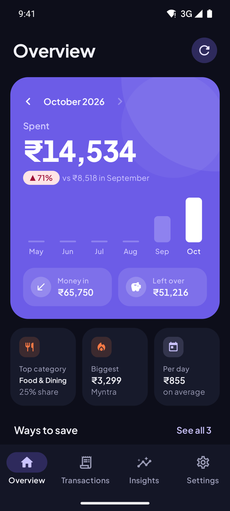
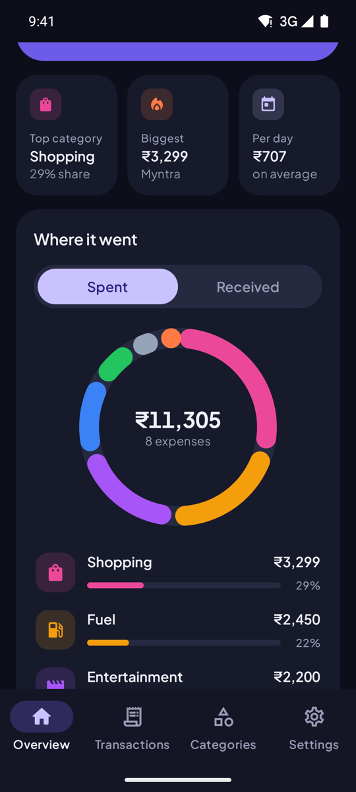
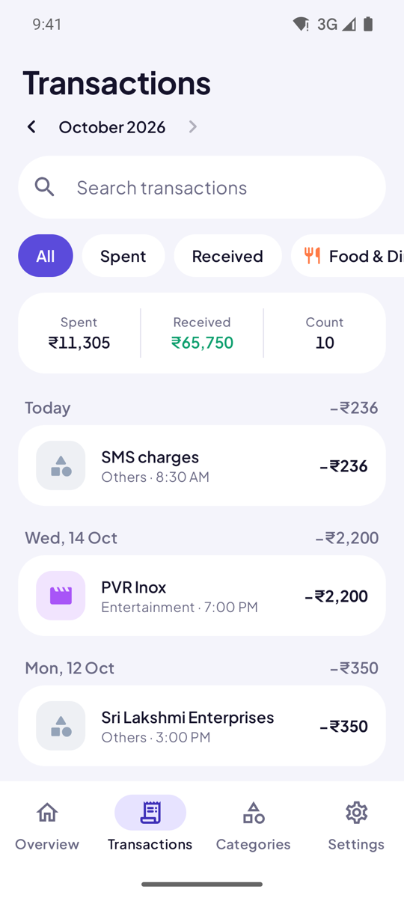
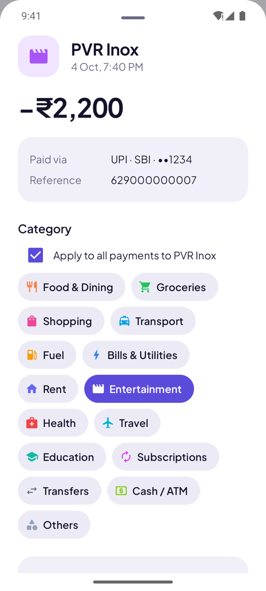
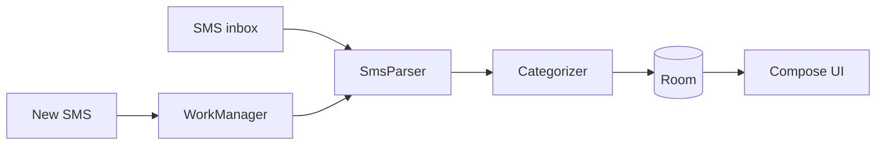

<div align="center">


# Spendwise

**Know where your money went without lifting a finger.**<br>
Spendwise does the bookkeeping for you, privately, on your phone.


[](LICENSE)
[](https://github.com/PriyamKeshri/Spendwise/releases/latest)






</div>

## Features

- **Past and new messages**: choose how far back to read (last month up to everything). New bank SMS show up within seconds.
- **Automatic categories**: 15 spending and 5 income categories. Anything unmatched goes to **Others**.
- **Learns from you**: re-file a merchant once and its future payments follow.
- **Money in, too**: salary, refunds, interest and transfers from people.
- **No double counting**: credit card bill payments (CRED included) and transfers between your own accounts stay out of totals.
- **Private**: messages are read and stored only on the phone. The app has no internet permission.

## Install

> **Blocked by Play Protect?** In India and some other countries, Play Protect blocks apps that ask for SMS access when they're installed from a browser or file manager, and there's no "Install anyway" option. Installing over USB isn't affected.

**Over USB (recommended)**

1. On the phone, open Settings → About phone and tap **Build number** 7 times, then turn on **USB debugging** in Developer options. On Xiaomi, Redmi or POCO, also turn on **Install via USB**.
2. Connect it to your computer and tap **Allow** on the prompt.
3. Run `./install-on-phone.sh` from this repo, or `adb install Spendwise-v1.0.apk` with the APK from the [latest release](https://github.com/PriyamKeshri/Spendwise/releases/latest).

**From the download**

1. In the Play Store, tap your profile picture → **Play Protect** → ⚙ and turn off **Scan apps with Play Protect**.
2. Install the APK from the [latest release](https://github.com/PriyamKeshri/Spendwise/releases/latest), then turn scanning back on.

Then open Spendwise, choose how far back to read, and allow SMS access. If Android won't grant it, open App info → ⋮ → **Allow restricted settings** first.

## Tech stack

| Technology | Used for | Why |
|---|---|---|
| **Kotlin** | All app code | Google's recommended Android language. Null safety and coroutines keep parsing and I/O code short and safe. |
| **Jetpack Compose + Material 3** | Every screen | Declarative UI with far less code than XML views, plus ready-made accessible components and light/dark theming. |
| **Compose Canvas** | Donut, trend and daily charts | The charts are simple shapes, so drawing them directly avoids a charting library and keeps the app small. |
| **Coroutines + Flow** | Background work, live updates | The database emits Flows, so every screen refreshes on its own when a new SMS is imported. |
| **Room** (SQLite) | Transactions, categories, learned merchants | Compile-time-checked SQL, Flow support, and a unique index that makes re-reading the inbox safe. |
| **DataStore** | Sync position and settings | Asynchronous, type-safe replacement for SharedPreferences. |
| **WorkManager** | Inbox import and catch-up syncs | Runs reliably in the background, survives restarts, and reports progress to the UI. |
| **BroadcastReceiver** (`SMS_RECEIVED`) | Spotting new bank messages | Reacts the moment an SMS arrives instead of polling the inbox. |
| **Hilt** | Dependency injection | Wires the database, repository and background workers together with very little boilerplate. |
| **Navigation Compose** | Bottom-bar tabs | Keeps each tab's scroll and filter state when you switch between them. |
| **Plus Jakarta Sans** | Typography | A clean geometric typeface with tabular figures, so amounts line up neatly. |
| **JUnit** | Parser and categorizer tests | Bank message formats are the riskiest part, so they're tested against SBI, HDFC, ICICI, Axis and Kotak message formats. |

## How it works



- **SmsParser** pulls out the amount, debit or credit, merchant, account and UPI reference. It skips OTPs, offers, reminders and failed payments.
- **Categorizer** checks merchants you've sorted first, then category keywords (the longest match wins), then falls back to Others.

## Development

```bash
./gradlew testDebugUnitTest   # parser and categorizer tests
./gradlew assembleDebug       # APK in app/build/outputs/apk/debug/
./gradlew assembleRelease     # smaller, optimised APK in app/build/outputs/apk/release/
```

Needs JDK 17 and the Android SDK (compile SDK 35, min SDK 26). When a bank message isn't recognised, add it as a case in `SmsParserTest.kt` and adjust `SmsParser.kt` until it passes. Category keywords live in `DefaultCategories.kt`.

## Licence

Spendwise is released under the [MIT Licence](LICENSE). The bundled Plus Jakarta Sans font is © The Plus Jakarta Sans Project Authors, under the [SIL Open Font License 1.1](app/src/main/assets/licenses/plus_jakarta_sans_OFL.txt).
